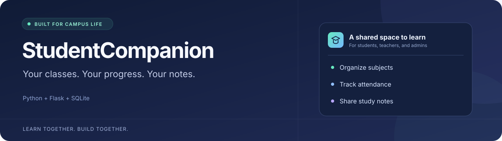

<p align="center">
  
</p>

# StudentCompanion

**Keep classes, attendance, and study notes together.**

A lightweight Flask and SQLite project for students, teachers, and administrators. The application calls itself **EduCompanion**; this repository is its home.


[Quickstart](#quickstart) · [Features](#features) · [Contribute](CONTRIBUTING.md) · [Deployment](DEPLOYMENT.md)

> **Project status:** The backend is runnable, but the HTML templates and static assets are not committed yet. Browser pages currently fail with `TemplateNotFound`. Health, registration, login, authenticated summary, and logout flows were verified during environment setup. A working browser demo is the first roadmap goal below.

## Features

The backend includes these workflows; their browser views still need the missing templates.

| Area | What it supports |
| --- | --- |
| Accounts | Student registration, session login, and admin/teacher/student roles |
| Subjects | Teachers and admins manage subjects and course codes |
| Attendance | Each student tracks their own attendance, with month, quarter, and semester views |
| Class notes | Teachers and admins upload files up to 15 MB; signed-in users filter and download notes by subject |
| JSON endpoints | Public health check and a session-authenticated summary of subjects, notes, and attendance |

## Quickstart

Use **Python 3.11+** and Bash on Linux or macOS. Environment setup was verified with Python 3.12. The application uses SQLite, so no separate database server is needed.

```bash
git clone https://github.com/Akash-a-15/StudentCompanion.git
cd StudentCompanion
python3 -m venv .venv
source .venv/bin/activate
python -m pip install -r requirements.txt
```

Configure a fresh local database instead of using the bundled demo database. Choose an admin password of at least 12 characters; it is used only when the database has no admin account.

```bash
mkdir -p .local/notes
export DATABASE_PATH="$PWD/.local/student_companion.db"
export UPLOAD_DIR="$PWD/.local/notes"
export FLASK_ENV=development
export FLASK_SECRET_KEY="$(python -c 'import secrets; print(secrets.token_hex(32))')"
export ADMIN_USERNAME=admin
read -r -s -p "Choose an admin password (12+ characters): " ADMIN_PASSWORD
printf '\n'
export ADMIN_PASSWORD

gunicorn --bind 127.0.0.1:8000 --workers 2 --preload wsgi:app
```

The generated session key is shared by both workers. Running the key-generation command again invalidates existing sessions. `--preload` initializes the database before the workers are forked.

In another terminal, check the running app:

```bash
curl --fail --silent --show-error http://127.0.0.1:8000/api/health
```

Expected JSON:

```json
{"app": "EduCompanion", "status": "ok"}
```

The health endpoint works independently of the missing browser templates. `/api/summary` requires a logged-in session and redirects anonymous requests to `/login`.

## Configuration

The app reads exported variables and can also load a local `.env` file. Keep credentials private. `.env.example` shows a starting point; the full set of runtime paths is listed here.

| Variable | Purpose |
| --- | --- |
| `FLASK_SECRET_KEY` | Session signing key; use a stable, private value in deployment |
| `DATABASE_PATH` | SQLite database file; quickstart uses `.local/student_companion.db` |
| `UPLOAD_DIR` | Uploaded notes directory; quickstart uses `.local/notes` |
| `ADMIN_USERNAME` | Initial admin username; at least 3 characters |
| `ADMIN_PASSWORD` | Initial admin password; at least 12 characters |
| `FLASK_ENV` | `development` for local HTTP; `production` enables secure session cookies and requires HTTPS |

The bundled `student_companion.db` contains disposable demo data. Future contributions should keep databases, uploaded files, and real student information out of Git. See [deployment notes](DEPLOYMENT.md) for persistent storage and production configuration.

## Find your way around

```text
app.py                  Flask routes, validation, roles, and SQLite setup
wsgi.py                 WSGI entry point
requirements.txt        Python dependencies
Dockerfile              Container build
Procfile / render.yaml  Hosting startup configuration
DEPLOYMENT.md           Deployment prerequisites and examples
CONTRIBUTING.md         How to propose and validate a contribution
docs/                   Project banner and publishing checklist
```

There is no automated test suite yet. Dependency consistency can be checked with `python -m pip check`; validate behavior with the health request above and the flows affected by your changes.

## Help shape the project

Small, focused contributions are welcome. Useful next steps:

- [ ] Restore HTML templates and static assets so the browser workflow works.
- [ ] Add integration coverage for accounts, permissions, attendance, and notes.
- [ ] Review authentication and CSRF behavior before a public app deployment.
- [ ] Add screenshots from the running UI and a short walkthrough once the views work.

Found a problem? [Report a bug](https://github.com/Akash-a-15/StudentCompanion/issues/new?template=bug_report.yml). Have an idea? [Suggest a feature](https://github.com/Akash-a-15/StudentCompanion/issues/new?template=feature_request.yml). Include the student or teacher task it would improve.

If the project is useful to you, a star helps others discover it. Read [CONTRIBUTING.md](CONTRIBUTING.md) before opening a pull request.

## License

A license has not been selected yet. A public repository alone does not grant reuse or redistribution rights; contact the repository owner before reusing the code.
